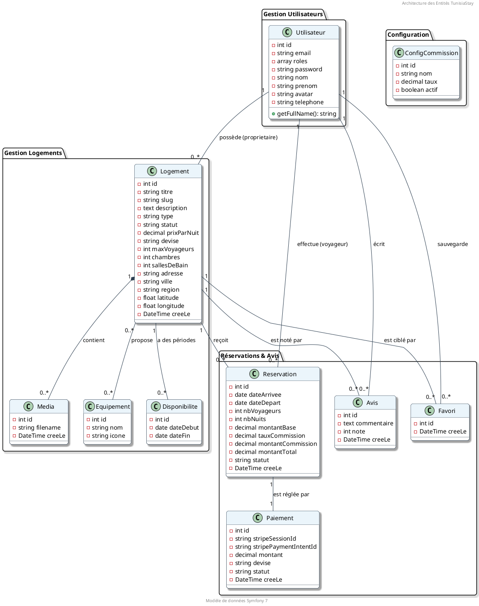

# 🏗️ Diagramme de Classes - TunisiaStay

Ce document présente le diagramme de classes technique pour la plateforme **TunisiaStay**, modélisé avec PlantUML. Il reflète l'architecture de la base de données et les relations entre les entités Symfony.

---

## 📐 Diagramme PlantUML

---

## 🔍 Détails des Relations

### 🔗 Utilisateur & Logement
- Un **Utilisateur** (Propriétaire) peut posséder plusieurs **Logements** (1:N).
- Un **Logement** appartient obligatoirement à un seul propriétaire.

### 📅 Réservations
- Une **Reservation** lie un **Voyageur** (Utilisateur) à un **Logement** (1:N dans les deux sens).
- Chaque réservation est associée à un **Paiement** unique (1:1) via l'identifiant Stripe.

### 🏠 Logement & Services
- **Équipements** : Relation ManyToMany (N:M). Un logement peut avoir plusieurs équipements (WiFi, Piscine, etc.) et un équipement peut être présent dans plusieurs logements.
- **Media** : Relation OneToMany (1:N). Un logement peut avoir plusieurs photos.
- **Disponibilité** : Permet de définir des plages de dates spécifiques où le logement est réservable.

### 📊 Configuration
- **ConfigCommission** : Entité isolée gérée par l'administrateur pour définir les taux appliqués lors des calculs de réservation.
