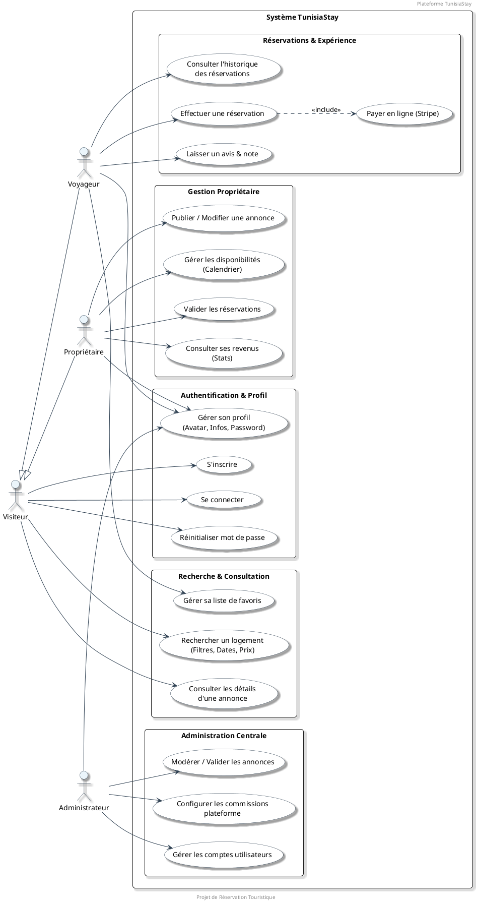

# 📊 Diagramme de Cas d'Utilisation - TunisiaStay

Ce document présente le diagramme de cas d'utilisation professionnel pour la plateforme **TunisiaStay**, modélisé avec PlantUML.

## 🎭 Acteurs du Système
- **Visiteur** : Utilisateur non authentifié qui explore la plateforme.
- **Voyageur** : Utilisateur connecté souhaitant réserver des séjours.
- **Propriétaire** : Utilisateur proposant des hébergements à la location.
- **Administrateur** : Super-utilisateur gérant la plateforme et les configurations.

---

## 📐 Diagramme PlantUML

---

## 📝 Description des Cas d'Utilisation

### 🔐 Authentification & Profil
- **S'inscrire / Se connecter** : Permet l'accès aux fonctionnalités avancées.
- **Gérer son profil** : Chaque utilisateur peut modifier son avatar, ses informations personnelles et son mot de passe.

### 🔍 Recherche & Consultation
- **Recherche multicritères** : Filtrage par destination, type de logement, prix et nombre de voyageurs.
- **Favoris** : Permet aux voyageurs de sauvegarder des annonces pour plus tard.

### 💳 Réservations & Paiements
- **Réservation** : Sélection de dates via un calendrier interactif.
- **Paiement Stripe** : Intégration sécurisée pour la validation financière du séjour.

### 🏠 Gestion Propriétaire
- **Annonces** : Publication de photos, équipements et descriptions.
- **Calendrier** : Gestion dynamique des périodes de disponibilité.

### 🛡️ Administration
- **Modération** : Validation des annonces avant publication pour garantir la qualité.
- **Commissions** : Ajustement global du pourcentage prélevé sur les transactions.
